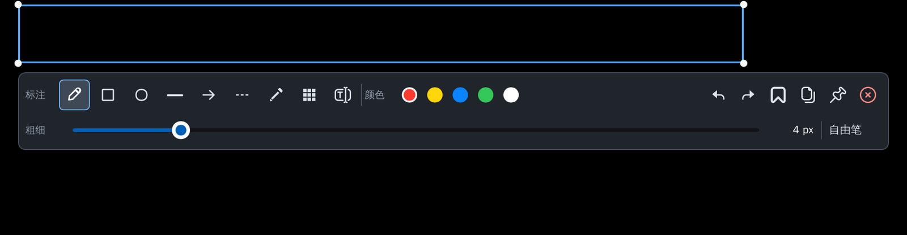

<div align="center">
  

  # Babry for macOS

  **[Babry](https://github.com/kregonia/babry) 的 macOS 移植：一款懂边界的截图工具。**

  悬停吸附 · 单击确认 · 拖动精修 · 原位标注 · 一键复制
</div>

<br>

<div align="center">
  
  <br>
  <sub>界面与上游一致，截图来自上游 Linux 版。</sub>
</div>

## 来源

本项目移植自 [kregonia/babry](https://github.com/kregonia/babry)（Apache-2.0）。第一个提交原样导入上游 `497f87d`，后续改动见 git 历史和 [NOTICE](NOTICE)。

CV 智能选区、标注渲染、撤销历史、命令行解析和 Slint 界面直接沿用上游代码；本仓库只替换了和 Linux / Wayland 绑定的部分。

## 当前状态

| 功能 | 状态 | 说明 |
| --- | --- | --- |
| CV 智能选区 | ✅ | 沿用上游，单测在 macOS 上通过 |
| 标注、文字、马赛克/模糊 | ✅ | 文字默认使用系统自带的冬青黑体 |
| 拖动边框调整选区 | ✅ | 进入标注后拖动四条边或四个角点 |
| 保存 PNG | ✅ | 保存到 `~/Pictures/babry-时间.png` |
| 复制到剪贴板 | ✅ | 写入 `NSPasteboard`，类型为 PNG |
| 全屏覆盖窗口 | ✅ | 无边框窗口盖住菜单栏和 Dock，已实机验证 |
| Babry.app 与 DMG | ✅ | 通用版本；未经 Apple 公证，首次打开需手动允许 |
| 多显示器 | 🧪 | 截取鼠标所在的屏幕，或用 `--output` 指定 |
| 贴图 | ✅ | 浮在普通窗口之上，可移动、缩放、调整大小，可同时钉多张 |
| 全局快捷键、菜单栏常驻 | ✅ | 默认 `⌃⌥S` 智能截图、`⌃⌥F` 全屏截图，可以录制修改；支持开机启动 |
| ScreenCaptureKit | ✅ | 进程内截图，不启动子进程、不写临时文件 |

## 安装

1. 从 [Releases](https://github.com/jiangdengke/babry-mac/releases/latest) 下载 `Babry-版本号.dmg` 并打开。需要 macOS 14 或更高版本，Apple 芯片和 Intel Mac 都能运行。
2. 把 Babry 拖到“应用程序”文件夹。
3. 第一次打开时，macOS 会提示无法验证开发者，因为这个 App 没有经过 Apple 公证。到“系统设置 → 隐私与安全性”点“仍要打开”，或在终端运行 `xattr -dr com.apple.quarantine /Applications/Babry.app`。
4. 打开后 Babry 常驻菜单栏。第一次截图时，在“系统设置 → 隐私与安全性 → 录屏与系统录音”中允许 Babry，然后再按一次快捷键。每次更新版本后可能需要重新允许。

### 从源码构建

需要 Rust 1.89 或更高版本（代码使用了 let chains 和 `File::try_lock`）。

```bash
git clone https://github.com/jiangdengke/babry-mac.git
cd babry-mac
scripts/package-macos.sh        # 生成 dist/Babry-版本号.dmg
cargo run --release -- --screen # 开发时直接运行
```

## 运行

第一次打开 Babry（双击、Spotlight 或 Launchpad）后，它常驻菜单栏，之后用快捷键或菜单截图：

| 操作 | 方式 |
| --- | --- |
| 智能截图：悬停吸附，点击确认 | `⌃⌥S`，或菜单“智能截图”，或再次打开 Babry |
| 全屏截图并直接进入编辑 | `⌃⌥F`，或菜单“全屏截图” |
| 修改快捷键 | 菜单“设置快捷键…”，直接录制按键 |
| 开机自动运行 | 菜单“开机时启动” |
| 退出 | 菜单“退出 Babry” |

编辑窗口开着时再按快捷键会被忽略，不会叠加第二张截图。

菜单栏图标放不下时，macOS 会把它折叠成 `«`，刘海屏上很常见。这时快捷键不受影响，关掉几个其他图标就能看到它。

需要参数时，用 `open -n` 另外启动一个实例：

```bash
open -n -a Babry --args --region              # CV 智能区域截图
open -n -a Babry --args --screen              # 截取整个屏幕并直接进入编辑
open -n -a Babry --args --output NAME         # 在指定显示器截图，可与 --screen 组合
/Applications/Babry.app/Contents/MacOS/babry --list-outputs   # 列出显示器名称、位置和缩放
/Applications/Babry.app/Contents/MacOS/babry --help
```

Babry 已经在运行时，不带 `-n` 的 `open -a` 会丢掉参数，只触发一次智能截图。

直接在终端运行 App 里的 `babry` 也可以：不带参数是一次性智能截图，`babry --menu-bar` 是常驻菜单栏。这时录屏权限算在终端身上。

## 修改快捷键

点菜单“设置快捷键…”，在窗口里点录制框，按下新的组合键就会保存，关闭窗口后生效。点录制框里的 `×` 可以取消绑定，“恢复默认”回到 `⌃⌥S` 和 `⌃⌥F`。录制时按 `Esc` 取消。

组合键要带 `⌃`、`⌥` 或 `⌘`，只有 F1 到 F12 可以单独使用。全局快捷键会盖过所有应用里的同名快捷键，选的时候要注意。默认值避开了 `⌘⇧3/4/5`（系统截图）、`⌘⇧S`（很多应用的“另存为”）、`⌥⇧F`（编辑器的格式化文档）和 `⌃⇧` 系列（kitty 等终端的默认前缀）。

设置保存在 `~/Library/Application Support/Babry/hotkeys.json`，也可以手动编辑，下次启动 Babry 时生效：

```json
{
  "region": "ctrl+alt+s",
  "screen": "ctrl+alt+f"
}
```

### 用 Raycast 触发

不需要 Raycast 也能用快捷键。如果想从 Raycast 里搜索或绑定：

1. 打开 Raycast 设置 → Extensions → `+` → Add Script Directory，选择本仓库的 `scripts/raycast`。
2. 在列表里找到“Babry 智能截图”和“Babry 全屏截图”，按需设置 Hotkey。不要和 Babry 自己的快捷键设成同一组按键，否则一次会截两张。

脚本通过 `open -n -a Babry` 启动 App，所以录屏权限只需要给 Babry，不需要给 Raycast。

## 交互方式

### 选区阶段

1. 移动鼠标：吸附到窗口、面板或控件。
2. 滚轮向上：扩大到父区域；向下：缩小到子区域。
3. 单击：确认当前选区，进入编辑。
4. 按住拖动：切换为手动框选。
5. `Esc`：取消截图。

### 编辑阶段

| 操作 | 快捷键 |
| --- | --- |
| 撤销 / 重做 | `⌘Z` / `⌘⇧Z` 或 `⌘Y` |
| 保存 | `⌘S` |
| 复制 | `⌘C` |
| 确认文字 | `⌘↩`，或点击画布外 |
| 取消文字或截图 | `Esc` |

Slint 在 macOS 上把 `Control` 映射为 `⌘`，所以界面文件里的快捷键不用改。

### 贴图

点击工具栏的图钉，选区会保存到 `~/Pictures` 并钉在屏幕上；截图窗口关闭后贴图仍然保留。也可以把已有图片钉上去：`open -a Babry --args --pin /图片的/绝对路径.png`。

| 操作 | 效果 |
| --- | --- |
| 左键拖动 | 移动贴图 |
| 拖动边或角 | 调整大小，最小 64 点 |
| 滚轮 | 以中心缩放 |
| 右键或 `Esc` | 关闭这张贴图 |

## 字体

文字标注依次尝试：`BABRY_FONT` 环境变量、冬青黑体（Hiragino Sans GB）、华文黑体（STHeiti）、Arial Unicode、Helvetica。

```bash
export BABRY_FONT="/System/Library/Fonts/STHeiti Medium.ttc"
export BABRY_FONT_INDEX=0   # .ttc 字体集合中的索引
```

## 与上游的差异

| 上游（Linux） | 本仓库（macOS） | 文件 |
| --- | --- | --- |
| `grim` 截屏 | ScreenCaptureKit 按屏幕矩形截取（macOS 15.2 起），macOS 14 按显示器截取 | `src/capture.rs` |
| `wl-copy` | `NSPasteboard` | `src/capture.rs` |
| `notify-send` | `osascript` 通知 | `src/capture.rs` |
| niri / Hyprland IPC | `NSScreen` | `src/display.rs` |
| niri `binds` 绑定快捷键 | 内置全局快捷键、菜单栏常驻进程和设置窗口 | `src/hotkeys.rs`、`src/menu_bar.rs`、`src/settings_window.rs`、`ui/settings.slint` |
| niri `open-fullscreen` 窗口规则 | 无边框的非激活面板，层级高于菜单栏 | `src/overlay.rs` |
| layer-shell 贴图 | 浮动层级的无边框窗口，每张贴图一个进程 | `src/pin.rs`、`src/pin_window.rs`、`ui/pin.slint` |
| `/usr/share/fonts`、`fc-match` | macOS 系统字体 | `src/editor.rs` |

## 路线图

- [x] 覆盖窗口、Retina、贴图、DMG 打包
- [x] 全局快捷键和菜单栏常驻
- [ ] 外接显示器实测
- [ ] 通知改用 `UNUserNotificationCenter`，来源显示为 Babry
- [x] 换成 ScreenCaptureKit
- [ ] 签名和公证；用窗口边框辅助 CV 吸附

## 开发

发布新版本：把 `Cargo.toml` 的版本改成新版本号并提交，再推送同名 tag，例如 `git tag v0.2.0 && git push origin v0.2.0`。`release` 工作流会编译通用版本的 Babry.app，打成 DMG 并创建 Release，依赖的编译结果从 master 上 `macos` 检查保存的缓存读取；本地可以用 `scripts/package-macos.sh` 试打包。App 图标由 `scripts/make-icon.sh` 从 logo 生成。

```bash
cargo fmt --all
cargo clippy --all-targets -- -D warnings
cargo test --all-targets
```

### 复现吸附问题

设置 `BABRY_DEBUG_DIR` 后，每次截图都会在该目录保存原始全屏图（`babry-debug-时间.png`）和选区记录（`babry-debug-时间.log`）。记录包括悬停、滚轮切换和最终选区。

```bash
open -a Babry --env BABRY_DEBUG_DIR=$HOME/babry-debug
/Applications/Babry.app/Contents/MacOS/babry --debug-selection ~/babry-debug/babry-debug-时间.png /tmp/cv   # 离线查看全部候选
```

## License

[Apache License 2.0](LICENSE)。上游版权归 Babry 的作者所有，详见 [NOTICE](NOTICE)。
