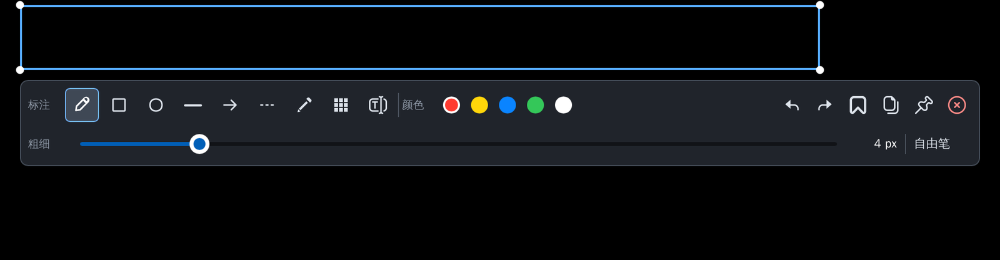

<div align="center">
  

  # Babry for macOS

  **[Babry](https://github.com/kregonia/babry) 的 macOS 移植：一款懂边界的截图工具。**

  悬停吸附 · 单击确认 · 拖动精修 · 原位标注 · 一键复制
</div>

<br>

<div align="center">
  
  <br>
  <sub>界面与上游一致，截图来自上游 Linux 版。</sub>
</div>

## 来源

本项目移植自 [kregonia/babry](https://github.com/kregonia/babry)（Apache-2.0）。第一个提交原样导入上游 `497f87d`，后续改动见 git 历史和 [NOTICE](NOTICE)。

CV 智能选区、标注渲染、撤销历史、命令行解析和 Slint 界面直接沿用上游代码；本仓库只替换了和 Linux / Wayland 绑定的部分。

## 当前状态

| 功能 | 状态 | 说明 |
| --- | --- | --- |
| CV 智能选区 | ✅ | 沿用上游，单测在 macOS 上通过 |
| 标注、文字、马赛克/模糊 | ✅ | 文字默认使用系统自带的冬青黑体 |
| 保存 PNG | ✅ | 保存到 `~/Pictures/babry-时间.png` |
| 复制到剪贴板 | ✅ | 写入 `NSPasteboard`，类型为 PNG |
| 全屏覆盖窗口 | 🧪 | 无边框窗口盖住菜单栏和 Dock，需要实机验证 |
| 多显示器 | 🧪 | 截取鼠标所在的屏幕，或用 `--output` 指定 |
| 贴图 | ❌ | 计划用置顶的 `NSPanel` 实现 |
| 全局快捷键、菜单栏常驻 | ❌ | 计划中；目前可以用 Raycast、快捷指令或 skhd 绑定 |
| ScreenCaptureKit、.app 打包 | ❌ | 目前调用系统的 `screencapture` |

## 构建与运行

需要 Rust 1.88 或更高版本（代码使用了 let chains）。

```bash
git clone https://github.com/jiangdengke/babry-mac.git
cd babry-mac
cargo build --release --locked
./target/release/babry
```

第一次截图时，macOS 会要求录屏权限。请在“系统设置 → 隐私与安全性 → 录屏与系统录音”中允许你使用的终端（Terminal、iTerm2、Ghostty 等），然后重启终端。

```bash
babry                  # CV 智能区域截图：悬停吸附，单击确认
babry --screen         # 截取整个屏幕并直接进入编辑
babry --output NAME    # 在指定显示器截图，可与 --screen 组合
babry --list-outputs   # 列出显示器名称、位置和缩放
babry --debug-selection screenshot.png /tmp/babry-cv-debug  # 离线检查 CV 选区
babry --help
```

## 交互方式

### 选区阶段

1. 移动鼠标：吸附到窗口、面板或控件。
2. 滚轮向上：扩大到父区域；向下：缩小到子区域。
3. 单击：确认当前选区，进入编辑。
4. 按住拖动：切换为手动框选。
5. `Esc`：取消截图。

### 编辑阶段

| 操作 | 快捷键 |
| --- | --- |
| 撤销 / 重做 | `⌘Z` / `⌘⇧Z` 或 `⌘Y` |
| 保存 | `⌘S` |
| 复制 | `⌘C` |
| 确认文字 | `⌘↩`，或点击画布外 |
| 取消文字或截图 | `Esc` |

Slint 在 macOS 上把 `Control` 映射为 `⌘`，所以界面文件里的快捷键不用改。

## 字体

文字标注依次尝试：`BABRY_FONT` 环境变量、冬青黑体（Hiragino Sans GB）、华文黑体（STHeiti）、Arial Unicode、Helvetica。

```bash
export BABRY_FONT="/System/Library/Fonts/STHeiti Medium.ttc"
export BABRY_FONT_INDEX=0   # .ttc 字体集合中的索引
```

## 与上游的差异

| 上游（Linux） | 本仓库（macOS） | 文件 |
| --- | --- | --- |
| `grim` 截屏 | `screencapture -R` 按屏幕矩形截取 | `src/capture.rs` |
| `wl-copy` | `NSPasteboard` | `src/capture.rs` |
| `notify-send` | `osascript` 通知 | `src/capture.rs` |
| niri / Hyprland IPC | `NSScreen` | `src/display.rs` |
| niri `open-fullscreen` 窗口规则 | 无边框窗口，层级高于菜单栏 | `src/overlay.rs` |
| layer-shell 贴图 | 待实现 | `src/pin.rs` |
| `/usr/share/fonts`、`fc-match` | macOS 系统字体 | `src/editor.rs` |

## 路线图

- [ ] P1：实机验证覆盖窗口、多屏和 Retina；处理焦点和输入法问题
- [ ] P2：菜单栏常驻、全局快捷键、`NSPanel` 贴图窗口
- [ ] P3：换成 ScreenCaptureKit；打包 `.app`，签名和公证；用窗口边框辅助 CV 吸附

## 开发

```bash
cargo fmt --all
cargo clippy --all-targets -- -D warnings
cargo test --all-targets
```

## License

[Apache License 2.0](LICENSE)。上游版权归 Babry 的作者所有，详见 [NOTICE](NOTICE)。
